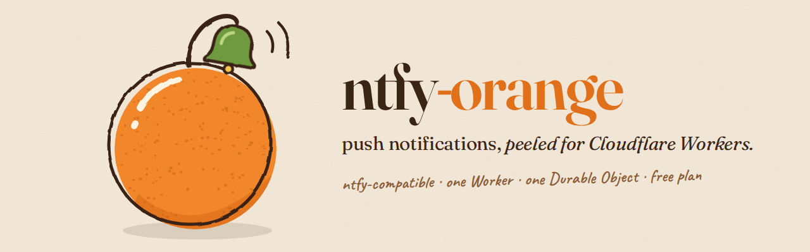

# ntfy-orange



<p align="center">
  <a href="https://github.com/tyrannyme/ntfy-orange/actions/workflows/ci.yml"><picture><source media="(prefers-color-scheme: dark)" srcset="https://shieldcn.dev/github/tyrannyme/ntfy-orange/ci.svg?variant=outline&amp;size=sm&amp;font=geist&amp;mode=dark"></picture></a>
  <a href="https://developers.cloudflare.com/workers/"><picture><source media="(prefers-color-scheme: dark)" srcset="https://shieldcn.dev/badge/runs%20on-Cloudflare%20Workers-F6821F.svg?variant=secondary&amp;size=sm&amp;font=geist&amp;mode=dark"></picture></a>
  <a href="docs/compatibility.md"><picture><source media="(prefers-color-scheme: dark)" srcset="https://shieldcn.dev/badge/ntfy-compatible-22C55E.svg?variant=secondary&amp;size=sm&amp;font=geist&amp;mode=dark"></picture></a>
  <a href="#ai-agents-mcp"><picture><source media="(prefers-color-scheme: dark)" srcset="https://shieldcn.dev/badge/MCP-%2Fv1%2Fmcp-3B82F6.svg?variant=secondary&amp;size=sm&amp;font=geist&amp;mode=dark"></picture></a>
  <a href="LICENSE"><picture><source media="(prefers-color-scheme: dark)" srcset="https://shieldcn.dev/badge/license-MIT-71717A.svg?variant=secondary&amp;size=sm&amp;font=geist&amp;mode=dark"></picture></a>
</p>

A self-hosted [ntfy](https://ntfy.sh)-compatible push notification server that runs entirely on
Cloudflare Workers: one Worker plus one SQLite-backed Durable Object. You don't need a server,
containers, an external database or a paid plan.

If you already use ntfy, point your apps and scripts at your Worker's URL and credentials and keep
going. The official Android app, the `ntfy` CLI, `curl` scripts and integrations that speak the
ntfy HTTP API work unchanged.

- **Private by default.** Anonymous access is denied until you allow it. Users and ACLs use the
  same syntax as ntfy's `auth-users` / `auth-access`.
- **Access tokens without redeploying.** Create, limit and revoke tokens at `/account` or with
  ntfy's token API. Tokens can be limited to topics and to publish-only or read-only.
- **Real-time.** WebSocket, JSON stream, SSE and raw subscriptions, with keepalives and filters.
- **History and offline recovery.** Messages are cached for 7 days by default. `since=` / `poll=1`
  replay, so phones catch up after being offline.
- **Scheduled messages.** `Delay` / `At` / `In` with durations, timestamps and phrases like
  `tomorrow, 9am`. Scheduled messages can be updated or canceled via sequence IDs.
- **Full metadata.** Titles, priorities, tags/emojis, Markdown, click URLs, icons, action
  buttons, attachments (upload or URL), and updating, clearing and deleting notifications.
- **UnifiedPush and Matrix.** `up*` topics and `/_matrix/push/v1/notify`.
- **iOS.** Optional `poll_request` forwarding to ntfy.sh for instant iOS delivery.
- **AI agents.** A built-in MCP server at `/v1/mcp` to publish, read history, and wait for replies.
- **Low idle cost.** Subscriptions are hibernatable WebSockets, so an idle phone connection costs
  one tiny alarm every 45 seconds and an idle server with no subscribers costs nothing.

Compatibility comes from the official docs plus black-box testing against the official server.
75 differential test cases compare responses byte-for-byte after normalization. See
[docs/compatibility.md](docs/compatibility.md) for what's covered, what isn't, and why.

## Deploy

You need a free Cloudflare account, [Bun](https://bun.sh) and Node.js (for `wrangler`).

```sh
git clone https://github.com/tyrannyme/ntfy-orange && cd ntfy-orange
bun install
bun run wrangler login
```

Create your user as a **secret**. Passwords must be at least 12 characters.

```sh
openssl rand -base64 24                       # generate a password

# Format: <user>:<password>[:admin|user], comma- or newline-separated
bun run wrangler secret put NTFY_AUTH_USERS
#  > phil:K3x...long-password...:admin

bun run deploy
```

That's the only secret you need. Access tokens for apps and scripts are created while the server
runs (see [Access tokens](#access-tokens)).

Wrangler prints your URL, e.g. `https://ntfy-orange.<you>.workers.dev`. To serve it on a
[custom domain](https://developers.cloudflare.com/workers/configuration/routing/custom-domains/)
in a zone on your Cloudflare account, deploy with `bun run deploy --domain ntfy.example.com`, or
add `"routes": [{ "pattern": "ntfy.example.com", "custom_domain": true }]` to `wrangler.jsonc`.
Then try it:

```sh
curl -u phil:PASSWORD -d "Hello from Cloudflare" https://ntfy-orange.<you>.workers.dev/test
curl -H "Authorization: Bearer tk_..." "https://ntfy-orange.<you>.workers.dev/test/json?poll=1"
```

To redeploy on every push to `main`, fork the repository and add `CLOUDFLARE_API_TOKEN` and
`CLOUDFLARE_ACCOUNT_ID` as repository secrets. The Deploy workflow runs after CI passes. Your users
and tokens stay in Worker secrets, so a deploy never touches them.

> **Note:** If you skip `NTFY_AUTH_USERS`, everything is denied (unless you open topics with
> `NTFY_AUTH_ACCESS`). That's intentional: a fresh deployment is never an open relay.

## Access tokens

Give every app, script or agent its own token, so you can revoke one without touching the rest.

**In a browser:** open `https://your.host/account`, sign in, pick a name, topics and permission,
and copy the token. It's shown once. The same page lists your tokens, and edits or revokes them.

**From a terminal**, with ntfy's token API:

```sh
# A token for everything your user can access
curl -u phil:PASSWORD -X POST https://your.host/v1/account/token -d '{"label":"laptop"}'

# Publish-only, limited to two topics (wildcards allowed), expiring in 30 days
curl -u phil:PASSWORD -X POST https://your.host/v1/account/token \
  -d '{"label":"backup","topics":["backups","alerts-*"],"permission":"write-only","expires":'$(($(date +%s)+30*86400))'}'

# Change a token's limits later; the token itself stays the same (null resets a limit)
curl -u phil:PASSWORD -X PATCH https://your.host/v1/account/token \
  -d '{"token":"tk_...","topics":["backups","alerts-*","reports"],"permission":"read-write"}'

curl -u phil:PASSWORD https://your.host/v1/account                                 # list (masked)
curl -u phil:PASSWORD -X DELETE -H "X-Token: tk_..." https://your.host/v1/account/token  # revoke
```

Use a token as `Authorization: Bearer tk_...`, as the password with an empty username, or in
`?auth=`. Tokens take effect immediately, with no redeploy. Edits and revocation are immediate
on the Cloudflare instance that handled them and take up to a minute elsewhere.

- **Never expires by default.** Pass `expires` (Unix seconds) to set an expiry.
- **Limits only narrow access.** A token never gets more access than its user.
- **A limited token can't create or edit tokens.** It can revoke itself.
- **Only a hash is stored.** A lost token can't be recovered: revoke it and create a new one.

`NTFY_AUTH_TOKENS` still works for tokens you want in configuration. Those can't be revoked
through the API.

## Connect the Android app

1. Open **Settings → Manage users → Add user**. Enter your server URL, username and password.
2. Tap **+** to subscribe. Enter a topic, check **Use another server**, and enter the same URL.
3. Optional: set **Settings → Default server** to your URL so you can skip step 2's checkbox.

On self-hosted servers the app uses its foreground "instant delivery" service and keeps a
long-lived connection open. If your app version lets you choose the connection protocol, prefer
**WebSockets**. WebSockets and JSON streams both hibernate on the server side, but WebSockets
take one fewer hop.

**Tested on a device:** ntfy 1.25.2 on Android 15, against a live deployment. Notifications,
actions, attachments, updates, deletes, scheduled messages and catch-up after the app was stopped
all worked. On WebSockets the connection stayed up with the screen off, and notifications arrived
in about half a second. When the app suggests switching to WebSockets, accept. See
[docs/compatibility.md](docs/compatibility.md#verification-limits).

## Other clients

| Client                      | How                                                                                                                                                                   |
| --------------------------- | --------------------------------------------------------------------------------------------------------------------------------------------------------------------- |
| `ntfy` CLI                  | `ntfy publish -u phil:PASS https://your.host/topic "hi"`, or `--token tk_...`. `ntfy subscribe` works too. Tested in the suite.                                       |
| `curl` / scripts / webhooks | Any of the [ntfy publishing](https://docs.ntfy.sh/publish/) styles: headers, query params, `GET /topic/trigger`, JSON to `/`.                                         |
| iOS app                     | Set `NTFY_UPSTREAM_BASE_URL=https://ntfy.sh` (see below). The app gets a content-free "poll request" through ntfy.sh/APNs, then fetches the message from your server. |
| UnifiedPush                 | Allow anonymous write to `up*` topics: `NTFY_AUTH_ACCESS="*:up*:wo"`. Matrix homeservers can use `https://your.host/_matrix/push/v1/notify`.                          |
| Web app                     | Not included. Browsers get a short help page (see [trade-offs](docs/compatibility.md#not-supported)).                                                                 |

## AI agents (MCP)

`/v1/mcp` is a stateless [Model Context Protocol](https://modelcontextprotocol.io) server using
Streamable HTTP with JSON responses. It authenticates like the rest of the API, and every tool is
subject to your ACL.

| Tool                  | What it does                                                                                       |
| --------------------- | -------------------------------------------------------------------------------------------------- |
| `publish`             | Send a notification (title, priority, tags, Markdown, actions, delay, attachment URL, sequence ID) |
| `get_messages`        | Read cached history for topics (`since`, `limit`, priority/tag filters)                            |
| `wait_for_message`    | Block up to 5 minutes for the next message on topics, for "ask the human and wait" flows           |
| `delete_notification` | Delete or clear a notification, or cancel a scheduled one, by sequence ID                          |
| `list_topics`         | Topics you can read, with message counts and live subscriber counts                                |

```sh
# Claude Code (all projects)
claude mcp add --scope user --transport http ntfy https://your.host/v1/mcp \
  --header "Authorization: Bearer tk_..."
```

```toml
# Codex: ~/.codex/config.toml (or `codex mcp add ntfy --url ...`, then add the header line)
[mcp_servers.ntfy]
url = "https://your.host/v1/mcp"
http_headers = { Authorization = "Bearer tk_..." }
```

Give agents their own token from `/account`, limited to the topics they need, so you can revoke it
without touching your scripts. Non-interactive `codex exec` needs tool approval, for
example `-c 'mcp_servers.ntfy.tools.publish.approval_mode="approve"'`.

Here's a pattern that works well. The agent publishes a question with `http` action buttons that
POST the answer to a reply topic, then calls `wait_for_message` on that topic. Give the phone's
reply action a token that can only write to the reply topic.

## Configuration

Set secrets with `bun run wrangler secret put NAME`. Set plain settings in `wrangler.jsonc` →
`vars`, or as secrets. Defaults are in parentheses.

| Variable                                                | Meaning                                                                                                             |
| ------------------------------------------------------- | ------------------------------------------------------------------------------------------------------------------- |
| `NTFY_AUTH_USERS` _(secret)_                            | `user:password[:admin\|user]`, comma/newline separated. Admins can read and write every topic.                      |
| `NTFY_AUTH_TOKENS` _(secret, optional)_                 | Tokens kept in configuration: `user:tk_<29 chars>[:label]`. Usually you'll create tokens at `/account` instead.     |
| `NTFY_AUTH_ACCESS`                                      | ACL entries `user\|*:topic-pattern:rw\|ro\|wo\|deny`, e.g. `ben:alerts*:rw,*:up*:wo`. The most specific entry wins. |
| `NTFY_AUTH_DEFAULT_ACCESS` (`deny-all`)                 | Fallback for unmatched topics: `read-write`, `read-only`, `write-only` or `deny-all`.                               |
| `NTFY_BASE_URL` (request origin)                        | Public URL, used in attachment links and the iOS upstream hash. Set it if you use several hostnames.                |
| `NTFY_CACHE_DURATION` (`7d`)                            | How long messages stay in history. `0` disables the cache.                                                          |
| `NTFY_KEEPALIVE_INTERVAL` (`45s`)                       | Keepalive event interval. Keep it below 77s (the Android app's read timeout).                                       |
| `NTFY_ATTACHMENT_FILE_SIZE_LIMIT` (`15M`)               | Max upload size (≤ 100M).                                                                                           |
| `NTFY_ATTACHMENT_TOTAL_SIZE_LIMIT` (`250M`)             | Max stored attachments. `0` disables uploads.                                                                       |
| `NTFY_ATTACHMENT_EXPIRY_DURATION` (`24h`)               | Upload lifetime, capped at the message's expiry.                                                                    |
| `NTFY_MESSAGE_SIZE_LIMIT` (`4K`)                        | Larger bodies become attachments, like ntfy.                                                                        |
| `NTFY_MESSAGE_DELAY_LIMIT` (`3d`)                       | Max scheduling horizon.                                                                                             |
| `NTFY_TIMEZONE` (`UTC`)                                 | Default timezone for phrases like `9am`. Clients can override with `X-Timezone`.                                    |
| `NTFY_UPSTREAM_BASE_URL` / `NTFY_UPSTREAM_ACCESS_TOKEN` | iOS instant delivery via an upstream server (e.g. `https://ntfy.sh`). Off by default.                               |
| `NTFY_ENABLE_MCP` (`true`)                              | Set `false` to turn off `/v1/mcp`.                                                                                  |

Passwords live in Worker secrets, which are encrypted and can't be read back. ntfy's bcrypt hashes
aren't accepted: bcrypt would exceed the free plan's 10 ms CPU budget per request. See
[security](docs/architecture.md#security).

## Free tier

The design target is a personal server on the **Workers Free** plan. Here's a day with one phone
connected all day, 500 notifications and a few dozen reconnects:

| Resource (free daily limit)       | Approximate use                                                                              |
| --------------------------------- | -------------------------------------------------------------------------------------------- |
| Worker requests (100,000)         | ~600 (publishes, reconnects, polls)                                                          |
| Durable Object requests (100,000) | ~2,500 (including 1,920 keepalive alarms)                                                    |
| DO duration (13,000 GB-s)         | well under 100 GB-s. Hibernated objects aren't billed, and each alarm runs for milliseconds. |
| SQLite rows written (100,000)     | ~5,000 (one row per alarm, about 5 per stored message including indexes)                     |
| Storage (5 GB)                    | messages plus attachments, pruned automatically                                              |

With no subscribers and nothing scheduled, the server uses nothing at all: no alarms and no
wakeups. [docs/architecture.md](docs/architecture.md#cost-model) explains the numbers, and which
ones are estimates rather than measurements.

## Development

```sh
bun install
cp .dev.vars.example .dev.vars   # local users/tokens
bun run dev                      # wrangler dev on http://localhost:8787

bun run check                    # TypeScript (src + tests)
bun run lint                     # oxlint
bun run fmt                      # oxfmt
bun test                         # unit + end-to-end (boots wrangler dev automatically)
```

End-to-end tests run the real Worker and Durable Object in local `workerd`. Two extra suites use
the official ntfy binary as a black-box reference:

```sh
scripts/reference-server.sh &    # downloads and runs the official server on :2586
NTFY_REF_URL=http://127.0.0.1:2586 NTFY_BIN=~/.cache/ntfy-orange-ref/ntfy bun test
```

- `test/e2e/compat.test.ts` sends the same 75 requests to both servers and compares status, content
  type, JSON key order and values.
- `test/e2e/cli.test.ts` drives the official `ntfy` CLI against this server.

## Docs

- [docs/architecture.md](docs/architecture.md): design, cost model, security, scaling limits
- [docs/compatibility.md](docs/compatibility.md): feature matrix, trade-offs, what's unverified

## Contributing

See [CONTRIBUTING.md](CONTRIBUTING.md). Use the repository's [security policy](./SECURITY.md)
instead of a public issue for suspected vulnerabilities.

## License

MIT. This is an independent clean-room implementation, not affiliated with ntfy or ntfy.sh. "ntfy"
refers to the protocol it's compatible with.
